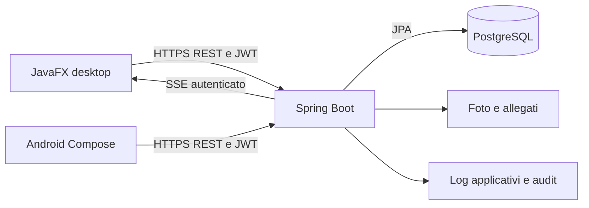

# Architettura

EA Project usa un **backend modulare unico**, condiviso da due client. Non è un’architettura a microservizi.

## Backend

I package distinguono controller, service, repository, domain, DTO e mapper per area. I controller ricevono l’utente autenticato dal contesto di sicurezza. I service applicano proprietà delle risorse, autorizzazioni e transazioni; i repository gestiscono query e lock.

- Un’istanza di viaggio/attività identifica una specifica occorrenza con date proprie.
- Una sola prenotazione attiva per Traveler e occorrenza; più partecipanti stanno nella stessa prenotazione.
- Creazione, pagamento e annullamento coordinano i lock sull’esperienza e sulla prenotazione per gestire concorrenza e disponibilità.
- Il prezzo salvato nella prenotazione è lo snapshot usato dal pagamento mock.
- La chat usa conversazioni autorizzate e SSE; il conteggio non letto rispetta lettura ed eliminazione personale.
- PostgreSQL contiene i dati; volumi separati conservano media e log in Docker.

## Client

JavaFX separa controller FXML, service API e componenti UI. La gerarchia CSS è `theme.css` → componenti condivisi tramite `app.css` → stili di schermata. Lo sfondo giornaliero alimenta gli accenti cromatici.

Android usa schermate Compose, repository di rete, DTO e componenti condivisi. Funzioni di dispositivo come camera, NFC e selezione foto richiedono solo gli accessi necessari al flusso attivato. La fotocamera del profilo produce JPEG in memoria, mostra l’anteprima e usa l’upload già previsto dall’account.

## Confini

JWT non sostituisce i controlli sulle singole risorse. I client non decidono proprietari o permessi. Il backend è l’autorità su posti, prezzi, stato delle prenotazioni e idoneità alle recensioni. Le funzioni non presenti su entrambi i client sono esplicitate nel [README](../README.md).
